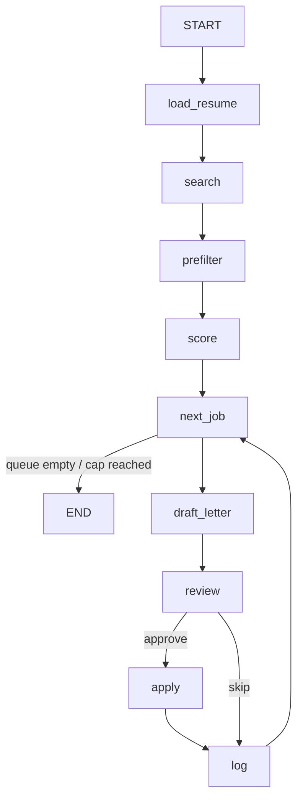

# JobHunter Agent

An autonomous job-application agent built on **LangGraph**. It searches LinkedIn and Naukri, filters and ranks jobs against your resume with **GPT-4o**, drafts a tailored cover letter for each one, fills out the application with **Playwright**, and logs every decision to **Google Sheets**.



| Node | What it does |
|---|---|
| `search` | Playwright scrapes LinkedIn (Easy Apply only, past week) and Naukri for every keyword/location pair |
| `prefilter` | Deterministic, no-LLM filters: jobs already seen in the sheet, excluded title keywords, excluded companies, remote-only |
| `score` | Fetches the full job description; GPT-4o returns a structured `{score, reason, seniority_ok}` |
| `draft_letter` | GPT-4o writes a specific 150–220 word cover letter grounded in your resume |
| `review` | **Human-in-the-loop** `interrupt()`: approve, edit the letter, or skip |
| `apply` | Fills the LinkedIn Easy Apply multi-step form (profile answers first, LLM fallback, gives up on anything it can't answer truthfully) or uses Naukri's native apply |
| `log` | Appends a row to Google Sheets (or `applications.csv`), which also deduplicates future runs |

## Setup

```bash
python3 -m venv .venv && source .venv/bin/activate
pip install -r requirements.txt
playwright install chromium

cp .env.example .env                       # add OPENAI_API_KEY
cp criteria.example.yaml criteria.yaml     # your searches, filters, profile answers
cp ~/path/to/resume.pdf resume.pdf

python -m jobhunter login                  # log in to LinkedIn and Naukri once, by hand
python -m jobhunter run
```

### Google Sheets (optional)
1. In Google Cloud, enable the **Google Sheets API** and create a **service account**. Download its JSON key as `service_account.json`.
2. Create a spreadsheet and share it with the service account's email (Editor).
3. Put the spreadsheet ID in `.env` as `GOOGLE_SHEET_ID`. The agent creates an `Applications` tab.

If Sheets isn't configured, everything is logged to `applications.csv`.

## Safety defaults
- `apply.submit: false`: forms are filled up to the final review step, and **nothing is submitted** until you flip it.
- `apply.require_approval: true`: you see every job and cover letter before the agent acts.
- `max_applications_per_run` caps volume. Randomised pauses keep the browsing pace human-like.
- Credentials never touch the code. You log in yourself, and the session is kept in `.browser_profile/`.

> LinkedIn's User Agreement prohibits automated activity on its site, and accounts can be restricted. Use low volumes, keep approval on, and use this at your own risk.

## Notes
- Site markup changes often. All selectors live in `SEL` in [`jobhunter/tools/browser.py`](jobhunter/tools/browser.py).
- `python -m jobhunter graph` prints the live Mermaid diagram of the compiled graph.

## Tests

```bash
pip install -r requirements-dev.txt
pytest
```

The suite drives the real compiled LangGraph with a fake browser, LLM and appliers. It checks filtering, score ranking, the human-review interrupt (approve, edit, skip), the application cap, dedupe across runs, error handling, and form-label matching. No network or API key is needed.
